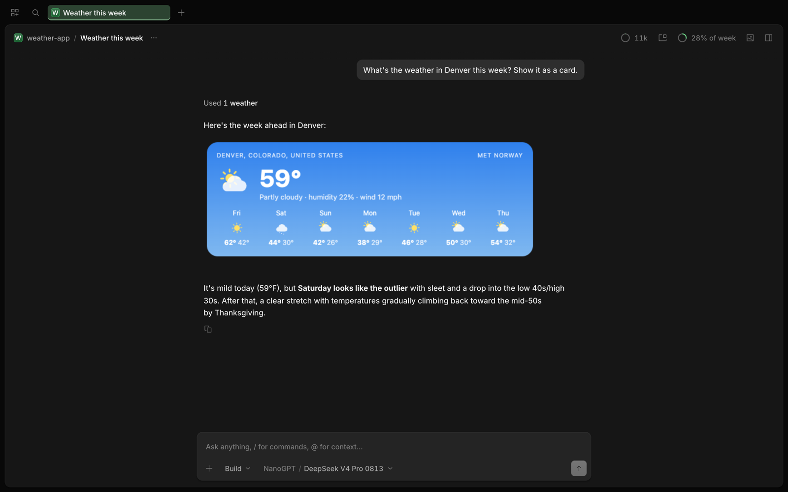
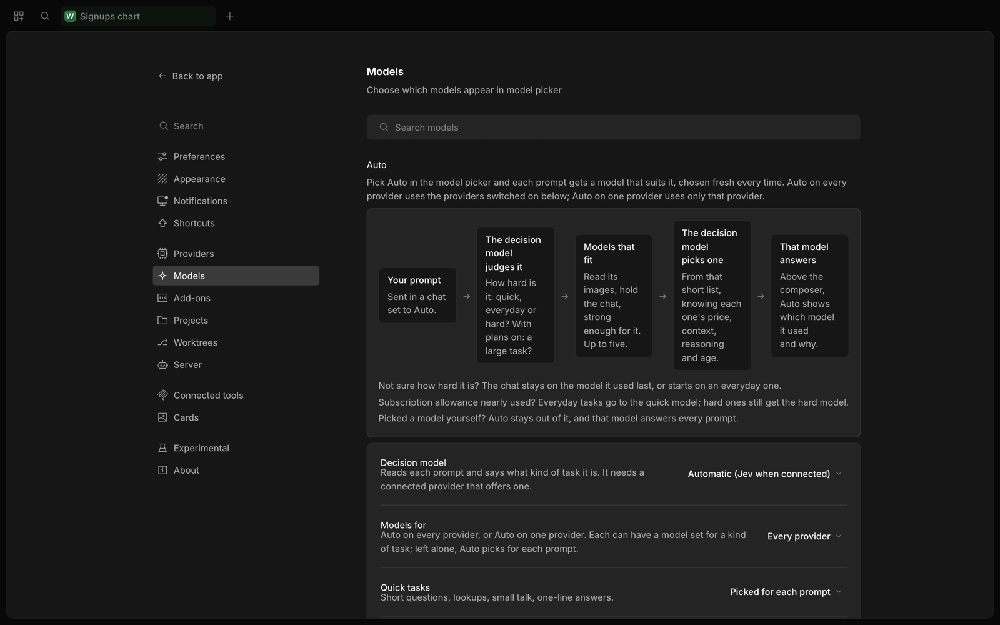
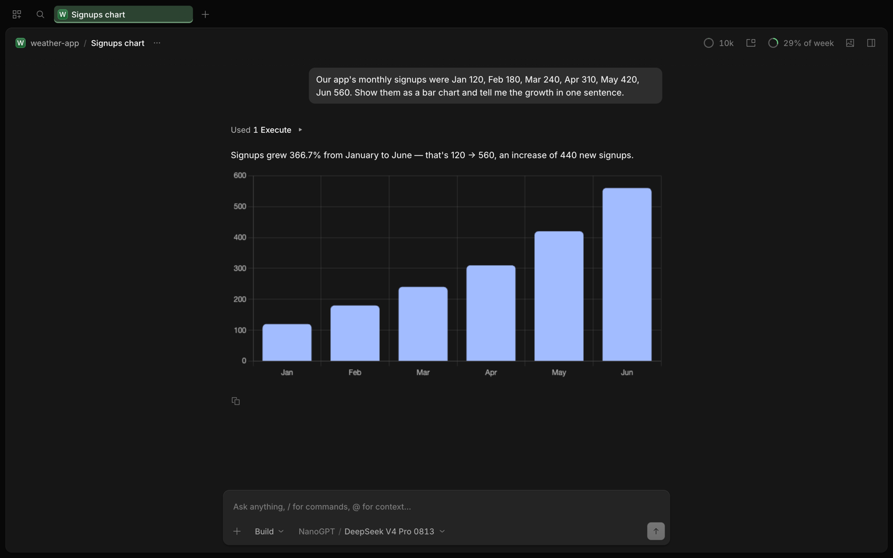
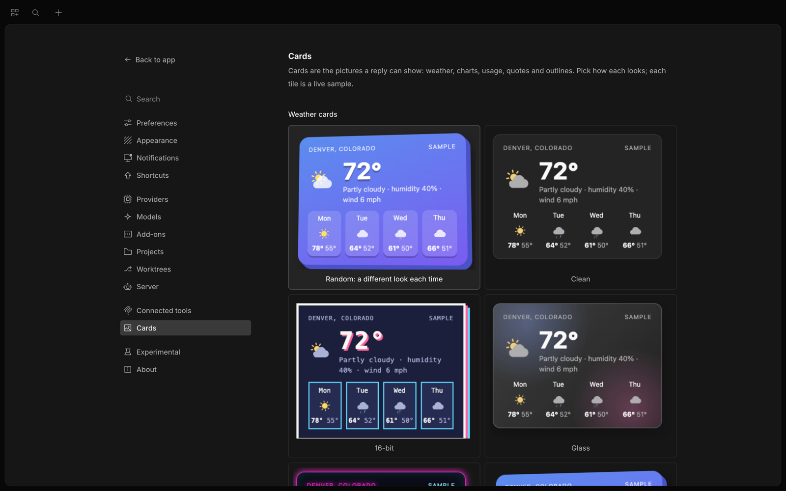
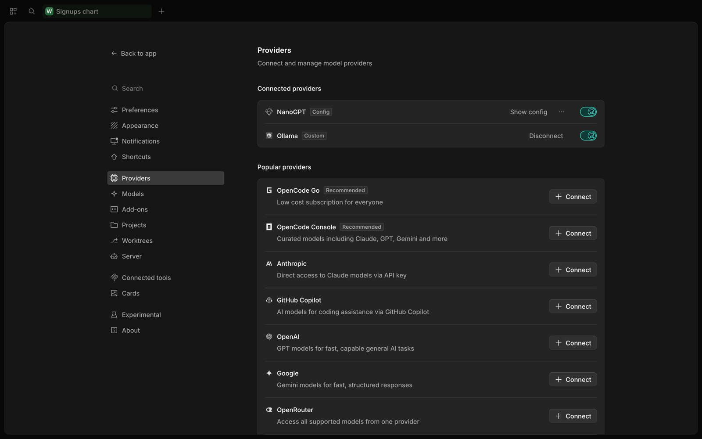

<p align="center">
  
</p>

<h1 align="center">JaCode</h1>

<p align="center">
  <strong>A desktop AI coding assistant that picks the right model for every prompt, keeps working on computers that stay on, and answers with live cards and charts.</strong>
</p>

<p align="center">
  <a href="https://github.com/toolingdev/jacode/releases/latest"></a>
  <a href="LICENSE"></a>
  
  <a href="JACODE.md"></a>
</p>

<p align="center">
  
</p>

JaCode is an open source desktop app for AI coding and everyday questions. It is built on
[OpenCode](https://github.com/anomalyco/opencode), the open source coding agent, and keeps everything OpenCode does:
agents that read and edit your code, run commands and use tools, with any model provider. JaCode adds a guided
desktop experience on top: one place to connect providers, automatic model routing, always-on workers, phone access
and answers drawn as cards.

## Features

### Auto: the right model for each prompt

Choose **Auto** in the model picker and every prompt gets a model that suits it. A small decision model judges how
hard the prompt is (quick, everyday or hard), JaCode narrows your connected models to the few that fit, and the
decision model picks one, weighing price, context, reasoning and age. It stays inside your subscription plans unless
you allow paid use, and shows which model answered and why.



### Answers as cards and charts

Replies can carry live visuals: charts, tables, weather, usage, quotes and outlines, drawn right in the chat. Each kind
has several looks to choose from, and every card runs sandboxed, with no network access.





### Workers: computers that stay on

Add a home server, a VPS or a Docker container as a **worker** with a guided setup that checks the machine and
installs everything over SSH. Start chats there, or ask any chat to schedule a task on a worker ("run this on the
worker tomorrow at 9"). The worker keeps going while your laptop sleeps, and results come back to the chat that asked.

### Use it from your phone

Pair a phone, tablet or another computer from Settings › Workers: scan a QR code and JaCode opens in the phone's
browser, with no app to install. Choose how devices reach you and in what order: **Tailscale** (private to your
devices), **Tailscale Funnel**, **OpenTunnel** (an end-to-end encrypted relay), the **same Wi-Fi**, or an address of
your own such as WireGuard or a reverse proxy. Each shows whether it works right now, and pairing hands out the
working ones in your order.

### Every provider in one place

Connect providers from a catalog, add any OpenAI-compatible provider by its address, view and edit a provider's
config in the app without exposing its keys, switch a provider off without removing it, and see plan usage and
credits across providers.



### And more

- **Chats without a folder** for conversations that aren't about code.
- **Automations**: run a prompt on a schedule, on an interval, or when a connected tool sends an event.
- **Add-ons** you switch on when you want them: tools (MCP servers), plugins and skills.
- **Exact time** from internet time servers, tabs colored by project, and unread dots that say where news came from.
- **English and Spanish** throughout.

## Download

Get the latest build from [Releases](https://github.com/toolingdev/jacode/releases/latest):

- **macOS (Apple silicon):** `JaCode-<version>-mac-arm64.zip`. Unzip it and move JaCode to Applications. The app
  isn't signed yet, so the first time, right-click JaCode and choose **Open**, or run
  `xattr -dr com.apple.quarantine /Applications/JaCode.app`.
- **Linux workers:** `opencode-linux-x64` and `opencode-linux-arm64`, the worker software for the machines you add
  as workers.

## Build from source

You need [Bun](https://bun.sh) and a Mac.

```bash
bun install
```

```bash
bun script/fork-install.ts --open
```

This builds the desktop app, installs it as `/Applications/JaCode.app`, builds the matching Linux worker software and
opens the app. JaCode keeps its settings and data apart from any other OpenCode install.

## Learn more

- [JACODE.md](JACODE.md): every feature, where it lives in the app, and its config keys.
- [JACODE-RELEASES.md](JACODE-RELEASES.md): what each release added and what it brought in from OpenCode.
- OpenCode's own documentation applies to everything JaCode inherits: [opencode.ai/docs](https://opencode.ai/docs).

## Credits and license

JaCode is an independent project built on [OpenCode](https://github.com/anomalyco/opencode) by Anomaly, and pulls in
OpenCode's improvements every week. It is not affiliated with or endorsed by the OpenCode team. Like OpenCode, it is
released under the [MIT license](LICENSE).
